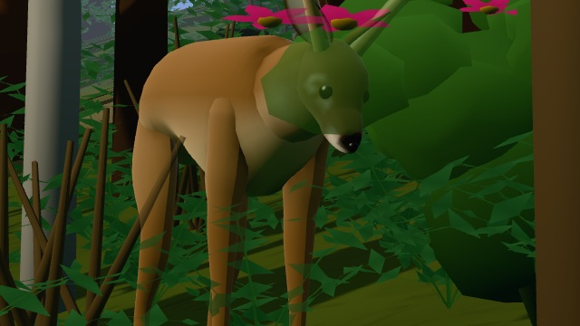
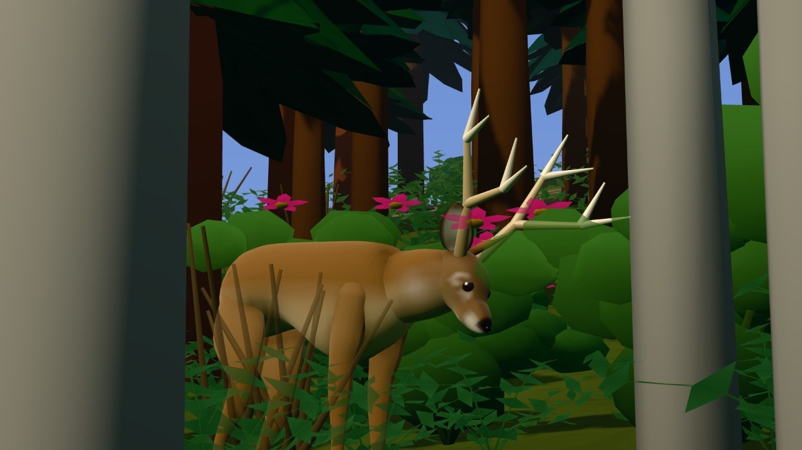
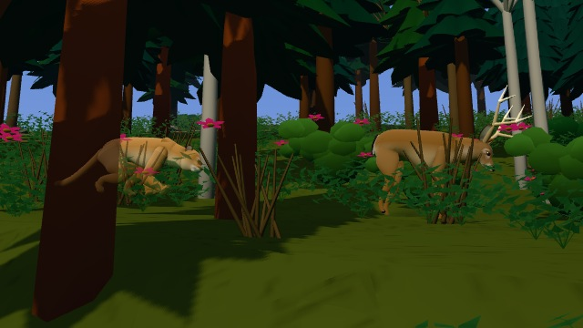
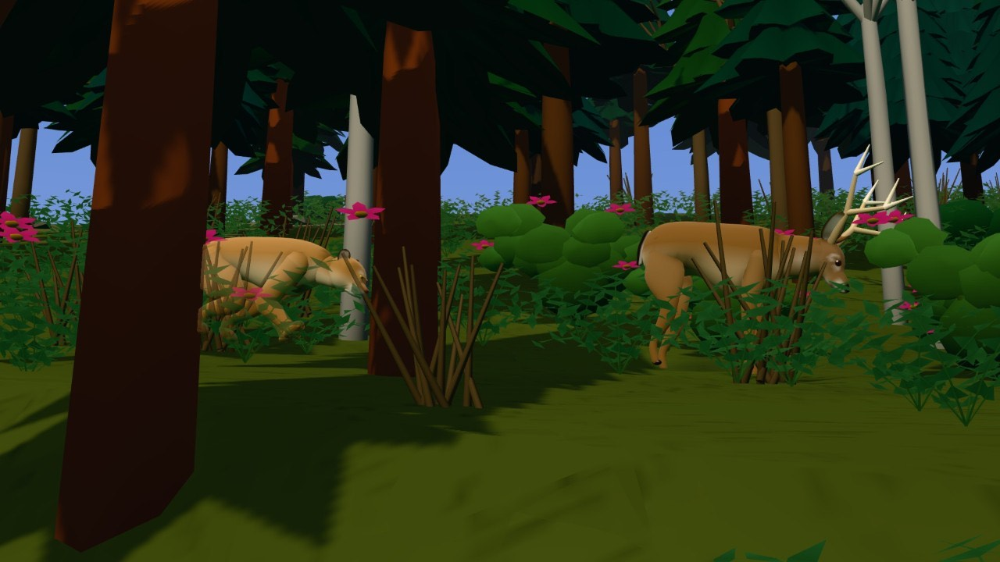
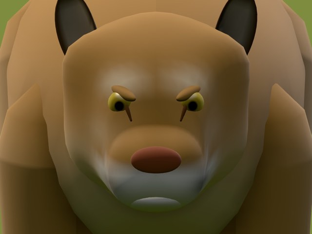

# s8: the intro film re-filmed with the batch's final look

Review it: `http://localhost:8347/tools/film-review.html` (with `python3 tools/serve.py` running from
this worktree). The game copy is `assets/intro/intro-film.mp4`; the rough cut is
`?cut=dist/intro-film/rough/intro-film-rough.mp4`.

## Done

- **Re-filmed with the final look**: horizon, colour, light, animal rim, s6's cougar and s7's
  black-tailed buck. Game 720p, game/website 1080p, last frame and `intro-film.json` rewritten by
  `tools/film-intro.mjs`.
- **Fix 1: the buck's whole head is in frame** (shot 2, "His ears").
  - Before: a 5.5° lens aimed at his eyes. His head with ears and rack was a whole frame tall, so
    the rack ran off the top. From that spot the salmonberry he browses also stood between the lens
    and his face, and the tracking lens showed the face faintly through the leaves: a green-washed face.
  - After: a 10° lens aimed 0.2 above his eyes (the middle of head and rack), from 2 m further round
    to the south-south-east, between two alders. The whole head, ears and antlers fit with room
    round them, and his face is clear. The cougar, which the wider lens would have shown behind him,
    is out of frame. Shot 5 ("Head up") keeps its old spot: his head is above the bush there.
  - **New check 7 in `tools/intro-film-motion.mjs`**: in every shot marked `frameHead` in the plan
    (ears, eyes, headup, watch) the key animal's whole head stays inside the frame, every frame, by
    at least 8% of the half-frame. The probe (`headBox` in `tools/intro-film-probe.mjs`) projects
    the model's own head vertices (skull, ears, antlers), dipped as the shader dips them for
    grazing and placed by the instance's matrix. Before: ears −105% (cut off by more than a
    half-frame). After: ears 39%, eyes 44%, headup 24%, watch 74%.

  | Before | After |
  |---|---|
  |  |  |

- **Fix 2: the tree in front of the cougar is solid** (shot 4, "The stalk").
  - Cause: the game's tracking lens (decision 0040), which the film turns on for each forest shot's key
    animal (Cole's F3 note). Its look-through pass draws the animal again faintly over cover close in
    front of it, but skips what lies behind the trunks near it. That trunk list was read only from the
    farm's own tiles. The film's forest is the border forest beyond the north fence, which has no farm
    tiles, so no trunk was ever listed there, and the cougar showed through every trunk in front of it.
  - Fix, in the game (`lookTrunks`, `js/render3d/scene.js`): beyond the farm's edge the trunk list
    also reads the border forest's trees from what flora drew (`flora.treeSites` by `canopyTile`),
    the same sites climbers already use.
  - Why change the game, not just the film: the bug is the same in play. Watch mode following an
    animal beyond the fence (deer waiting at it, decision 0053) showed it through the border trunks
    the same way. The lens's behaviour is otherwise unchanged: plants are still seen through faintly
    and opened near the lens; trunks were always meant to stay solid ("Trunks are never cut",
    0040). 0040's Rules gained a line.

  | Before | After |
  |---|---|
  |  |  |

- **The cougar's stutter step in the stalk** (Cole, after the first cut: "at 12 s the cougar
  stutter steps during the side view"). Its planned freeze at the buck's ear flick (12.8–13.6 s on
  the story's clock) had been cut down by the trims and the easing to about 0.25 s inside the 1.5 s
  shot. Its legs stopped and started again, which read as a stumble, not a freeze. The freeze is
  gone: it creeps steadily from 9.8 s to 15.9 s on the same path, at 0.59 m/s the whole shot (stalk
  limit 1 m/s). It still freezes when the buck looks up.
- **Cole's cougar update** (62acca3: broader skull top, no double chin, eyes set deeper with
  round forward pupils) is in the final film, with one change after Cole saw the first cut ("its eyes
  still look a little crossed"): each pupil's gaze is turned further out (`paint.gaze`, `cougarEye` in
  `quadrupeds.js`: out 0.3 to 0.5). Head-on, the pupils now sit in the middle of each eye instead of
  toward the nose. This changes the cougar in the game too.

  | Before | After |
  |---|---|
  |  |  |
- **The plan's first-shot idea** (item 10: open mid-distance in golden light, not on a close-up
  of a deer): the shot list Cole approved in F2/F3 already opens on a wide shot, the buck browsing
  at mid-distance in the forest with the creek at the left (`s8/opening-now.jpg`). I tried warmer, lower morning
  light and a higher aim for it, and kept neither (question 1).

("Before" stills are from the rough cut made at the start of this session, 640×360. "After" stills are from the final film, 1280×720.)

### Files

- Game: `assets/intro/intro-film.mp4`, 16.48 MB at quantizer 27, under its 16.5 MB budget with
  little room (15.4 MB before). `intro-film-last.jpg` and `intro-film.json` were rewritten too.
- Website, itch.io and the game's big-screen copy: `intro-film-1080.mp4`, 26.04 MB. At quantizer
  29 it came out 29.7 MB, over its 29 MB budget, so `film-intro.mjs` encoded it again at 30, one
  step coarser. The final look has more detail and costs more bytes.

### Checks

- `intro-film-check` passes: the film ends on the PNW start view at time 0.4501. `--live` passes
  too: the camera matches, with a mean pixel difference of 10.8/255 (11 before).
- `intro-film-motion` passes all 303 measures, including the new check 7.
- `intro-film-quality`: PSNR is 34–39 dB per shot, e.g. watch 38.8 dB / SSIM 0.95, start 36.0 / 0.91.
- `intro-playback-probe`:
  - unthrottled: 1080p starts at 1.9 s
  - CPU ×4: 1080p starts at 3.3 s
  - 4G: 720p starts at 9.9 s
  - 4G with CPU ×4: 1080p starts at 9.7 s
  - none of these runs stalled, dropped a frame or hitched
  - slow 3G: the film never plays and the game opens without it, as designed
- `lens-depth-browser-check` and `canopy-reveal-browser-check` pass (decision 0040's checks for the
  lens change). `website-check` passes; its only warnings are the old stale-capture warnings.
- Headless suite on the final branch, all 154 checks (`check-release.mjs`; it went on into the
  browser checks, which I stopped: they're main's job before an itch.io upload): 152 pass, 2 fail.
  - `waterfall-check` timed out under the suite's load. Run alone, it passes all 9 checks.
  - **`carcass-decay-check` fails: "pnw deer: horns, antlers or tusks touch the skull (gap 0.196
    skull lengths)".** That's s7's new black-tailed deer model. Nothing in s8 touches the models.
    Its fix (the antlers' place on the new skull, or the check's fitting of the new skull) belongs
    with the deer, before the batch's PR: its `headless` check would block the merge.

## Open questions for Cole

1. **Warmer dawn light for the forest shots?** The film's forest is lit at time of day 0.07, the
   "misty morning" from F2. At 0.015 the sun is low and orange: the trunks glow and it reads as
   golden morning (`s8/option-dawn-opening.jpg`), but the forest floor goes dark and the cougar is
   hard to see in the stalk (`s8/option-dawn-stalk.jpg`). *Recommendation:* keep 0.07. If you like
   the warmth, try 0.04 for the opening only; it's one number per shot in `tools/intro-film-shots.mjs`
   (`tod`).
2. **Thin stems over the cougar's face look see-through** in shot 3 (`s8/eyes-stems-through.jpg`).
   That's the tracking lens doing what you asked for in F3: plants in front of the animal are drawn
   faintly over it. Trunks are now solid, but salmonberry stems still are. *Recommendation:* keep the
   lens for plants. If you want stems solid too, the fix is a film-only gap through the stems on the
   line to the cougar's head (the film already clears shrubs for the stalk: `clearShrubs`).
3. **Shot 2 moved 2 m round to the south.** He's now seen a little more from the side, framed
   between two alders. *Recommendation:* keep. The old spot showed his face through the bush.

## New ideas

- Check 7 can take any close shot: mark a shot `frameHead: true` in `tools/intro-film-plan.mjs`.
  The website's staged clips (`tools/capture-site-video.mjs`) could use the same head measure.
- `headBox` reads only the tracked animal. Reading every cast animal's instance would let the
  check also guard the second animal in two-shots (the stalk, the burst).
- Other places the border forest is missing from a tiles-only lookup are worth a sweep: anything
  that reads `w.tree` near an animal that can stand beyond the fence.
